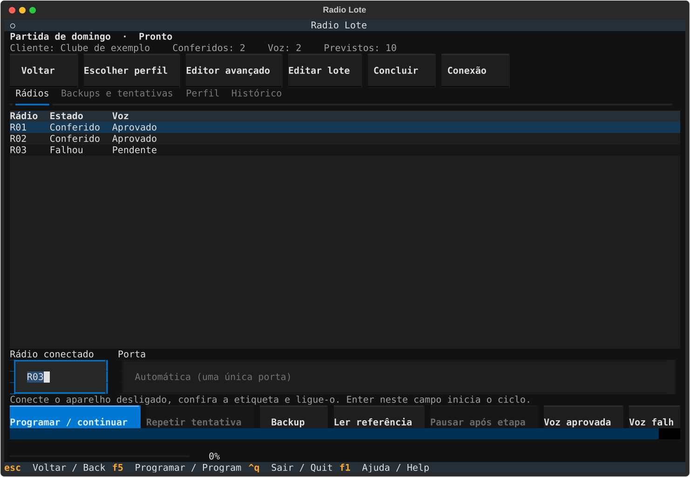

# radio-lote



[Português](README.md) · [Contributing](CONTRIBUTING.md) · [License](LICENSE)

A local terminal application for preparing and tracking batches of radios
compatible with [CHIRP](https://github.com/kk7ds/chirp)'s BF-888/H777 driver.
It keeps batches, profiles, backups and results together. Each radio gets its
own backup before an upload; a fresh download verifies its memory afterwards.

**Version 0.2 scope:** compatible members of the Baofeng 777/777S/888 family.
The protocol signature identifies compatibility, not an individual serial
number. This is not a universal programmer for every model supported by CHIRP.

| Platform | Status |
| --- | --- |
| macOS | Physical workflow validated with a compatible radio and USB serial cable. |
| Windows | Experimental; offline tests do not replace a physical pilot. |
| Linux | Experimental; offline tests do not replace a physical pilot. |

## Install

Python 3.12 or later is required. The Textual interface needs an interactive
terminal. Install a fixed release in an isolated environment:

```sh
uv tool install --python 3.12 https://github.com/danlflh/radio-lote/releases/download/v0.2.0/radio_lote-0.2.0-py3-none-any.whl
```

With pipx and an existing Python 3.12 installation:

```sh
pipx install --python 3.12 https://github.com/danlflh/radio-lote/releases/download/v0.2.0/radio_lote-0.2.0-py3-none-any.whl
```

Installing the source tag does not require a local Git executable:

```sh
uv tool install --python 3.12 https://github.com/danlflh/radio-lote/archive/refs/tags/v0.2.0.zip
```

Do not upgrade during a batch. Installation downloads dependencies; operation
and data storage are local. Docker, virtual machines and the CHIRP graphical
application are not required.

The PyPI project named `chirp` is unrelated. This application installs the
correct CHIRP revision using a source URL and hash. It is not published to
PyPI while that direct dependency remains in its package metadata.

## Start in the terminal interface

```sh
radio-lote
radio-lote --lang en
radio-lote doctor
```

1. Create or open a batch and choose its profile. One customer may have
   separate batches and histories.
2. Label the radios physically as **R01, R02…**. The USB cable does not identify
   the individual radio attached to it.
3. Close other applications using the cable. Attach the powered-off radio,
   then switch it on after seating the connector.
4. Read the first radio or import a known profile. Review the channels before
   starting uploads.
5. Start the indicated unit's cycle and wait for readback verification. Turn
   the radio off before moving the cable to the next unit.

Do not swap radios between backup and completion. After a failure, keep the
same physical label. If writing may have started, retry only verification.
Restoring a backup is an explicit operation.

## Choose a configuration

| Goal | Preparation |
| --- | --- |
| Four groups | Use four distinct frequencies read from the reference or supplied for the customer; review DCS and FM/NFM. |
| Join an existing group | Match the reference group's frequencies and tones without inventing new codes. |
| Advanced editing | Review memory positions by number, up to 16 on the supported model, and inspect the changes before applying them. |

The application does not choose random frequencies. A frequency already stored
in a radio does not establish that it is appropriate for the customer's use.
DCS filters received audio; it does not provide privacy or prevent interference
on the same frequency.

The four-group workflow preserves unselected positions on each radio. Power,
general options and bytes outside the permitted fields are also preserved.
Each attempt records the profile values used for that operation.

## Command line

`radio-lote ui` explicitly opens the terminal interface. Commands are also
available for batch operations and inspection. Replace `BATCH_ID` and
`ATTEMPT_ID` below with identifiers shown by the application.

```sh
radio-lote batch list
radio-lote batch create "New event" --client "Customer" --quantity 10
radio-lote batch show BATCH_ID
radio-lote profile list
radio-lote profile import profile.json --name "Customer profile" --batch BATCH_ID
radio-lote program --batch BATCH_ID
radio-lote backup --batch BATCH_ID --radio R01
radio-lote verify --batch BATCH_ID --attempt ATTEMPT_ID --radio R01
radio-lote restore --batch BATCH_ID --attempt ATTEMPT_ID --radio R01
radio-lote status --batch BATCH_ID
radio-lote logs --batch BATCH_ID
```

`profile.json` must be a compatible, reviewed configuration; compatible CHIRP
`.img` files can also be imported. To read the connected radio, save its backup
and create a profile:

```sh
radio-lote profile capture --batch BATCH_ID --name "Customer profile"
```

Use `--existing-team` when capturing or importing an image to preserve an
existing group's tones. Select a saved profile with
`profile activate PROFILE_ID --batch BATCH_ID` before starting the batch.

`batch` also provides `archive`, `reopen`, `complete`, `duplicate`, `export` and
`import`. Each subcommand's `--help` describes file and destination arguments.
Do not manually edit attempt records. The earlier Portuguese commands remain
available for legacy compatibility.

## Data, backups and migration

Default data locations are independent of the Python environment:

- macOS: `~/Library/Application Support/radio-lote`.
- Windows: `%LOCALAPPDATA%\radio-lote`.
- Linux: `${XDG_DATA_HOME:-~/.local/share}/radio-lote`.

Use `radio-lote --dados PATH ...` to select another directory. Removing the
Python environment should not remove the backups in the data directory.

Each programming attempt stores its original image, prepared image, readbacks,
stages and hashes. Backups are never overwritten. A restore first saves the
currently connected radio before recovering the selected backup. Exports may contain
customer configurations and data; do not automatically attach them to public
issues.

To bring in older data, stop every operation using that directory, then run:

```sh
radio-lote migrate OLD_DATA_DIRECTORY
```

Migration copies the data and retains the source. Keep a separate backup and
review the imported records before retiring the old directory.

## Voice checks

Begin with two radios. Power-cycle both after programming, then check voice on
each channel in both directions without pressing MONI. For a four-group profile,
verify that different positions do not open each other's audio. Check the
remaining units against a reference radio.

Verified memory and a passed voice test are separate results. The application
does not measure RF or listen to the radio; a physical test is still needed.

## Development and license

See [CONTRIBUTING.md](CONTRIBUTING.md) for source installation, offline tests
and builds. CI uses synthetic images and an in-memory serial emulator, never
physical equipment.

radio-lote is licensed under **GPL-3.0-or-later**. [NOTICE](NOTICE) identifies
the exact CHIRP revision and credits. This is not an official CHIRP or Baofeng
product.
