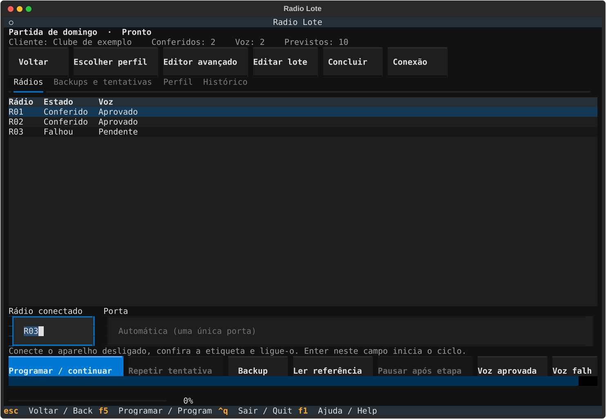

# radio-lote

[English](README.en.md) · [Contribuir](CONTRIBUTING.md) · [Licença](LICENSE)

Programa local para preparar e acompanhar lotes de rádios compatíveis com o
driver BF-888/H777 do [CHIRP](https://github.com/kk7ds/chirp). A interface de
terminal reúne lotes, perfis, backups e resultados. Cada aparelho recebe seu
próprio backup antes da gravação; uma nova leitura confere a memória ao final.



**Escopo da versão 0.2:** família Baofeng 777/777S/888 compatível com esse
driver. A assinatura do protocolo confirma compatibilidade, não o número de
série individual. Não é um programador universal de todos os modelos CHIRP.

| Sistema | Situação |
| --- | --- |
| macOS | Fluxo físico validado com aparelho compatível e cabo USB serial. |
| Windows | Suporte experimental; testes offline não substituem piloto físico. |
| Linux | Suporte experimental; testes offline não substituem piloto físico. |

## Instalar

Requer Python 3.12 ou superior e terminal interativo para a interface Textual.
Instale uma versão fixa em ambiente isolado, pelo wheel da release:

```sh
uv tool install --python 3.12 https://github.com/danlflh/radio-lote/releases/download/v0.2.0/radio_lote-0.2.0-py3-none-any.whl
```

Alternativa com pipx e Python 3.12 já disponível:

```sh
pipx install --python 3.12 https://github.com/danlflh/radio-lote/releases/download/v0.2.0/radio_lote-0.2.0-py3-none-any.whl
```

Para instalar da tag, sem depender de um Git local:

```sh
uv tool install --python 3.12 https://github.com/danlflh/radio-lote/archive/refs/tags/v0.2.0.zip
```

Use somente a release que pretende operar. Não atualize durante um lote.
A instalação baixa dependências; a programação e os dados ficam locais.
Não há necessidade de Docker, máquina virtual ou CHIRP gráfico.

O nome `chirp` no PyPI pertence a outro projeto. Esta aplicação instala a
revisão correta do CHIRP por URL e hash, e não é distribuída pelo PyPI enquanto
mantiver essa dependência direta.

## Começar pela interface

```sh
radio-lote
radio-lote --lang en
radio-lote doctor
```

1. Crie ou abra um lote e escolha seu perfil. Um mesmo cliente pode ter lotes
   distintos, com históricos próprios.
2. Identifique os aparelhos fisicamente como **R01, R02…**. O cabo USB não
   identifica qual unidade está conectada.
3. Feche outros programas que usem o cabo. Conecte o rádio desligado e ligue-o
   depois de encaixar o conector.
4. Leia o primeiro aparelho ou importe um perfil conhecido. Confira os canais
   antes de começar a gravar.
5. Inicie o ciclo da unidade indicada e aguarde a leitura de conferência.
   Desligue o rádio antes de trocar o cabo para a próxima unidade.

Não troque de aparelho entre o backup e o término do ciclo. Se a conexão
falhar, mantenha a mesma etiqueta; após uma possível gravação, a retomada faz
somente a conferência. Restauração é uma operação explícita.

## Escolher a configuração

| Objetivo | Como preparar |
| --- | --- |
| Quatro grupos | Usar quatro frequências distintas, obtidas da leitura ou informadas para o cliente; conferir DCS e FM/NFM. |
| Entrar em um grupo existente | Reproduzir as frequências e os tons do grupo de referência, sem criar códigos novos. |
| Edição avançada | Revisar as posições de memória por número, até 16 no modelo suportado, e conferir as alterações antes de aplicar. |

O programa não sorteia frequências. Uma frequência encontrada na memória não
comprova por si só que seu uso é adequado ao cliente. DCS filtra o áudio
recebido; não oferece privacidade nem elimina interferência na mesma frequência.

No fluxo de quatro grupos, as posições não selecionadas devem permanecer
como estavam em cada aparelho. Potência, opções gerais e bytes fora dos campos
autorizados também são preservados. Os valores do perfil ativo ficam registrados
com a tentativa, permitindo conferir o que foi aplicado.

## Linha de comando

`radio-lote ui` abre explicitamente a interface. Os comandos também permitem
operar ou consultar lotes pelo terminal; `--help` mostra os argumentos completos.
Nos exemplos, substitua `BATCH_ID` e `ATTEMPT_ID` pelos identificadores listados.

```sh
radio-lote batch list
radio-lote batch create "Novo evento" --client "Cliente" --quantity 10
radio-lote batch show BATCH_ID
radio-lote profile list
radio-lote profile import perfil.json --name "Perfil do cliente" --batch BATCH_ID
radio-lote program --batch BATCH_ID
radio-lote backup --batch BATCH_ID --radio R01
radio-lote verify --batch BATCH_ID --attempt ATTEMPT_ID --radio R01
radio-lote restore --batch BATCH_ID --attempt ATTEMPT_ID --radio R01
radio-lote status --batch BATCH_ID
radio-lote logs --batch BATCH_ID
```

`perfil.json` deve ser uma configuração compatível já conferida; também é
possível importar uma imagem CHIRP `.img`. Para ler o aparelho conectado,
salvar seu backup e criar o perfil:

```sh
radio-lote profile capture --batch BATCH_ID --name "Perfil do cliente"
```

Use `--existing-team` nessa leitura ou importação de imagem para manter os tons
do grupo existente. Um perfil salvo pode ser selecionado por
`profile activate PROFILE_ID --batch BATCH_ID` antes de iniciar o lote.

`batch` também oferece `archive`, `reopen`, `complete`, `duplicate`, `export` e
`import`. Consulte o auxílio de cada subcomando para escolher arquivo e destino;
não edite registros de tentativas manualmente. Os comandos anteriores em
português continuam disponíveis para compatibilidade com o fluxo legado.

## Dados, backups e migração

O diretório padrão pertence ao usuário e é independente do ambiente Python:

- macOS: `~/Library/Application Support/radio-lote`.
- Windows: `%LOCALAPPDATA%\radio-lote`.
- Linux: `${XDG_DATA_HOME:-~/.local/share}/radio-lote`.

Use `radio-lote --dados CAMINHO ...` para escolher outro diretório. A
desinstalação do ambiente Python não deve remover os backups desse diretório.

Uma tentativa de programação guarda a imagem original, a imagem preparada,
as releituras e o registro de etapas e hashes. Os backups não são sobrescritos.
Mesmo uma restauração salva o estado atual antes de recuperar o backup escolhido.
Exportações podem conter configurações e dados do cliente: compartilhe-as
intencionalmente, sem anexá-las automaticamente a issues públicas.

Para trazer os dados da versão anterior, encerre qualquer operação naquele
diretório e execute:

```sh
radio-lote migrate CAMINHO_DO_DIRETORIO_ANTIGO
```

A migração copia os dados e mantém a origem. Faça uma cópia de segurança do
diretório antigo e confira o resultado antes de abandonar seu uso.

## Conferência de voz

Comece com dois aparelhos. Depois de programá-los, desligue e ligue ambos;
teste voz em cada canal nos dois sentidos, sem pressionar MONI. No perfil de
quatro grupos, confira também que posições diferentes não abrem áudio entre si.
Use um aparelho de referência para conferir as demais unidades.

Memória verificada e teste de voz são resultados separados: o software não
mede RF nem ouve o rádio. O teste físico continua necessário após o ciclo.

## Desenvolvimento e licença

Veja [CONTRIBUTING.md](CONTRIBUTING.md) para instalação a partir do código,
testes sem rádio e build. A CI usa imagens sintéticas e um emulador serial;
nunca conecta a equipamentos físicos.

radio-lote é **GPL-3.0-or-later**. Créditos e revisão exata do CHIRP estão em
[NOTICE](NOTICE). Não é um produto oficial do CHIRP ou da Baofeng.
